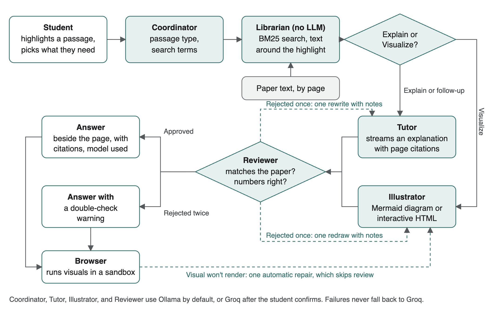

# Margin: a research paper tutor built with LangGraph

**Code:** [ADD YOUR GITHUB OR GOOGLE DRIVE LINK]

**How I used AI tools:** I directed the project and made the product decisions. Claude Code wrote nearly all of the code and tests and ran the evaluations.

## The problem and who it's for

Students reading research papers often get stuck on one passage, then lose their place while searching for help elsewhere. Margin is a calm PDF reader for them. You highlight what you don't understand, choose **Explain** or **Visualize**, and the answer appears beside the page while the rest of the paper fades. You can then ask for something simpler, deeper, or an example, or ask your own question.

## How it's built

- **Framework:** LangGraph (Python) behind FastAPI, with a React and pdf.js reader. Answers stream to the browser.
- **Multi-agent, with a fixed flow:**
  - **Coordinator:** works out what kind of passage it is and what to search for.
  - **Librarian:** retrieves related passages. This step is plain code and uses no LLM.
  - **Tutor:** writes the explanation, with citations to page numbers.
  - **Illustrator:** draws a Mermaid diagram or an interactive HTML visual.
  - **Reviewer:** checks the work against the paper and sends it back for one rewrite if needed.
- **RAG:** BM25 keyword search over the paper's text, plus the text around the highlight. The reference list is left out. There are no embeddings, since one paper is a small search space.
- **Memory:** each highlight keeps its own conversation, saved in the browser. The last six messages go back with each question. Nothing carries across papers.
- **Tools:** the agents don't choose tools. The graph decides the order, which keeps behavior predictable and limits model calls on slow hardware. The cost is that an agent can't decide on its own to look for more information.
- **Models:** Groq (`gpt-oss-120b` to write, `gpt-oss-20b` to coordinate and review) or Gemma 4 E4B on Ollama.

## One key design decision

**What I chose:** after building on Groq, I made a local model the default, with a toolbar switch to Groq. My reason was privacy and offline use: a student's papers shouldn't have to leave their computer.

**What I considered instead:** staying on Groq only, or a hybrid with local coordination and review while Groq did the writing. I ruled out the hybrid because paper text would still reach Groq.

**The tradeoff:** speed and some quality. In one timed comparison, Groq finished an explanation in 3.4 seconds and the local model took 24. An interactive visual took 87 seconds locally against 7 on Groq, and the local one was weaker. To keep the privacy promise, switching to Groq needs a confirmation, the app returns to the configured default on each open, an Ollama failure never falls back to Groq, and Ollama cloud models are refused. I accepted slower answers to keep that guarantee.

## How it was tested

- **Automated tests:** 106 tests (92 backend, 14 frontend) use a fake server that speaks Groq's and Ollama's APIs, so the real client libraries run over HTTP without needing a key. They cover routing, the rewrite loop, failures, and provider choice.
- **Browser checks:** a scripted run of the real app in headless Chrome, using the *Attention Is All You Need* paper.
- **Real model runs:** requests through Groq and Ollama, with the answers read by hand.

**What we learned:**

1. **Passing tests didn't prove good answers.** The first real run on Groq included a worked example with wrong softmax weights (0.71 and 0.29 instead of about 0.80 and 0.20), and it still passed review. The Reviewer is now told to recalculate every number. Tested three times each on that wrong example and a corrected version, it rejected the wrong one and approved the right one every time, on each model tried. The UI label also changed from "Checked" to "Reviewed against the paper. Mistakes are still possible."
2. **The obvious speedup would have broken the Reviewer.** Turning off the local model's thinking cut the Coordinator from 24 seconds to 4, but the Reviewer then rejected all three correct answers. So thinking stays on for the Reviewer and Illustrator and off for the others.
3. **Generated visuals run in a sandbox, and we checked it.** Because a paper's text could influence the code, visuals run in a locked-down frame. A test visual tried six ways to reach a local listener, and it received nothing.

**What this doesn't prove:** the evaluation uses one paper and one worked example, so it's a set of checks rather than a benchmark. No students have used it yet. I also haven't run it with the network off or monitored Ollama's own traffic.

## How it was deployed

It isn't deployed. It runs locally with `./run.sh`, which builds the frontend and serves everything from FastAPI at `127.0.0.1:8000`. It has run on a 16 GB M1 Pro, with Ollama holding about 10 GB of memory while the model is loaded.

## What I'd change

- **Evaluate first:** score explanations across a set of real papers with known hard passages, so a prompt change can be judged overall.
- **Make the Reviewer judge teaching:** a local visual passed review while showing raw `$d_k$` text and barely explaining the idea, because the Reviewer only checks accuracy.
- **Handle equations and figures:** selected equations often garble, and figures can't be highlighted. Sending an image of the selection to a vision model could fix this.
- **Test with students:** I'd want to see whether the calm interface actually helps them keep reading.

## What I built

This was a solo project, built with Claude Code.

- **My work:** the idea and audience, the visual direction, the choice of LangGraph, multi-agent, and Groq, the move to local for privacy, the request for a switch between providers, and which problems to fix after testing.
- **Claude Code's work:** the agent logic, prompts, retrieval, API, frontend, and tests, along with the fixed-graph design, the Reviewer's rewrite loop, and the switch's safeguards.

## Architecture diagram

